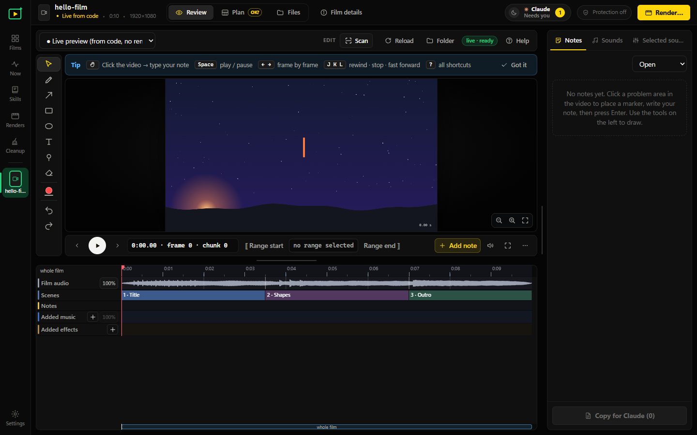
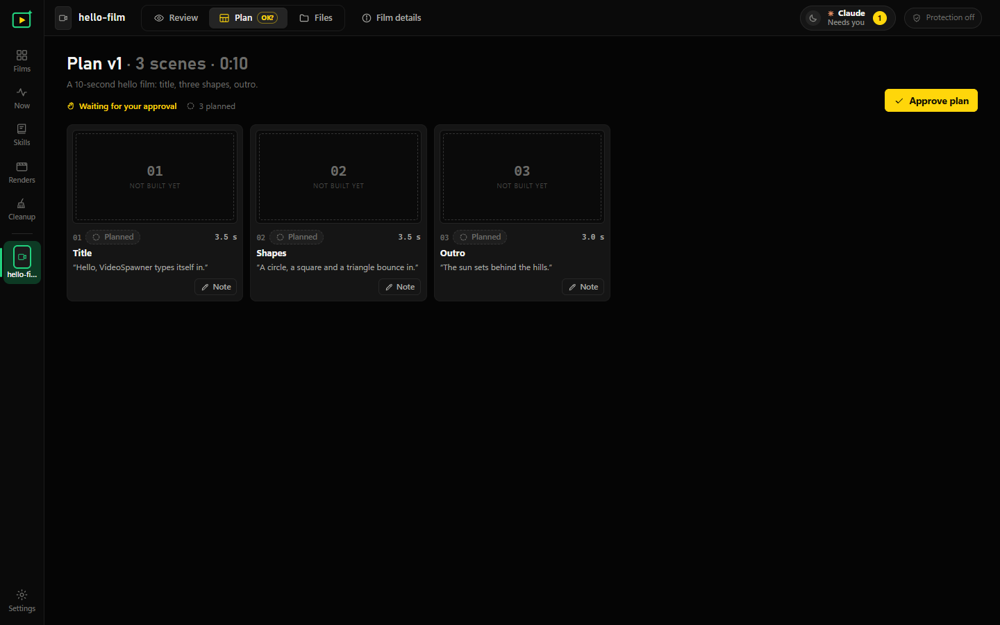
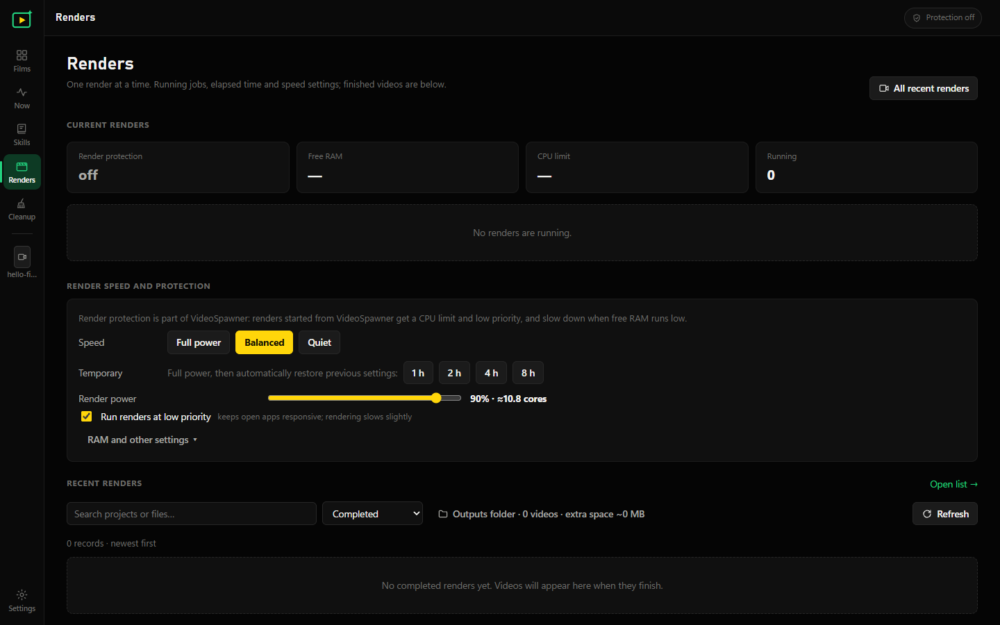

# VideoSpawner

**Студия для видео, которые пишет Claude Code. Смотришь черновик прямо из кода — без рендера, кликаешь по кадру с ошибкой, копируешь заметку в чат Claude. Финальный рендер запускаешь ты сам.**

by **arkentikov** · [Telegram](https://t.me/arkentikov) · [YouTube](https://www.youtube.com/@ArsenEcom-x9j)



> Windows 10/11 (основная платформа), Linux и macOS. Работает с Claude Code (а также Codex и OpenCode). Интерфейс на английском и русском (Настройки → Язык интерфейса).

---

## Что умеет

- **Живой черновик без рендера.** Видео играет прямо из кода: перемотка, покадрово, обновляется само, когда Claude меняет код.
  - фильмы VideoSpawner (страница с `window.renderOut(t)`);
  - **проекты Remotion**: VideoSpawner собирает проект его же Remotion (≈7 с) и играет любую композицию без рендера. Код поменялся — сам пересобирает.
- **Заметки на кадрах.** Кликни или нарисуй по кадру, напиши, что не так. Для Remotion картинка кадра точная — её снимает сам Remotion.
- **«Copy for Claude».** Кнопка копирует готовый промпт: все заметки со временем, кадром, текстом и картинкой. Ты сам вставляешь его в нужный чат Claude (Ctrl+V). Ничего не уходит само.
- **Чаты проекта.** На странице фильма видны чаты Claude Code, работавшие в его папке: выбираешь, в какой чат идут заметки, и копируешь команду, открывающую именно этот чат.
- **Импорт проектов.** «Import project» показывает твои проекты Claude Code (самые свежие сверху) — добавляешь в один клик.
- **Рендер, когда скажешь ты.** Очередь: один рендер за раз, защита CPU/RAM, перерендер только изменённых кусков. Для Remotion — кнопка «Финальный рендер» (родной `remotion render`).
- **Очистка.** Находит остатки рендеров и предлагает убрать — только в Корзину и только с твоего подтверждения.

## Сколько это стоит в токенах

**Само приложение не тратит ни одного токена** — оно работает у тебя на компьютере. Токены тратит только Claude, когда пишет код и читает заметки. VideoSpawner сокращает именно это:
- черновик смотришь без рендера, Claude не нужно рендерить, чтобы «проверить»;
- в промпте уже есть время, кадр и картинка нужного места — Claude не ищет его сам и не переспрашивает;
- после правки Claude не ждёт в цикле и не перечитывает фильм — он заканчивает ответ, а ты вставляешь следующие заметки, когда готов.

## Установка (один раз, отдельно от проектов)

VideoSpawner ставится **в свою отдельную папку один раз** и работает со всеми твоими проектами. В проекты ничего копировать не нужно.

1. Установи **Node.js 22+**, **ffmpeg** и **Chrome или Edge** (Windows):
   ```powershell
   winget install -e --id OpenJS.NodeJS.LTS
   winget install -e --id Gyan.FFmpeg
   ```
2. Скачай VideoSpawner в отдельную папку (например `D:\VideoSpawner`):
   ```powershell
   git clone https://github.com/KrArsen/VideoSpawner.git D:\VideoSpawner
   ```
   или **Code → Download ZIP** и распакуй.
3. Запусти установку: двойной клик по **SETUP.cmd** (или `node scripts/install.mjs setup`). Она спросит рабочую папку, какие агенты подключить (Claude Code), и создаст ярлык **VideoSpawner** на рабочем столе.
4. **Открой новый чат Claude Code** — в нём появятся инструменты VideoSpawner.

Можно и проще: открой папку VideoSpawner в Claude Code и напиши «установи VideoSpawner» — Claude сделает шаги сам.

Запуск: ярлык **VideoSpawner** или `open.cmd`. Адрес: http://127.0.0.1:7790.

## Как работать

**Новое видео с Claude**
1. В чате Claude Code попроси видео. Claude делает папку фильма и открывает живой черновик в VideoSpawner.
2. Смотри, кликай по кадрам, пиши заметки.
3. **Copy for Claude** → вставь в чат → Enter. Claude правит код, черновик обновляется сам.
4. Когда всё нравится — **Рендер…** (или «Финальный рендер» для Remotion).

**Проект Remotion, который у тебя уже есть**
1. **Import project** → выбери проект из списка.
2. На странице фильма: **Собрать просмотр** → выбери композицию → **Живой просмотр**.
3. Дальше так же: заметки → Copy for Claude → вставить в чат (на странице фильма можно выбрать, в какой чат).
4. **Финальный рендер** — когда решишь сам.

## Обновление и удаление

- Обновление: скачай новую версию рядом и запусти `UPDATE.cmd` (или `node scripts/install.mjs update --target "D:\VideoSpawner"`). Фильмы, заметки и настройки сохраняются.
- Удаление: `UNINSTALL.cmd` в папке VideoSpawner. Убираются только его ярлык и подключение к агентам; твои фильмы остаются.

## Вопросы

- **Remotion бесплатный?** Для частных лиц и команд до 3 человек — да. Компаниям от 4 человек нужна [лицензия Remotion](https://www.remotion.dev/license). VideoSpawner использует Remotion, установленный в твоём проекте.
- **Звук в черновике Remotion?** Пока черновик Remotion беззвучный; звук есть в финальном рендере.
- **Безопасно?** Сервер слушает только `127.0.0.1`. Не открывай порт 7790 наружу. Удаление — только в Корзину.

## Страницы

| | |
|---|---|
|  |  |
|  |  |
|  |  |

## Для разработчиков

`npm test` — все тесты. Архитектура: [docs/ARCHITECTURE.md](docs/ARCHITECTURE.md), контракт фильма: [docs/PROJECT-CONTRACT.md](docs/PROJECT-CONTRACT.md), правила для агентов: [CLAUDE.md](CLAUDE.md). Инструменты агента (MCP `videospawner`): `hub_live`, `hub_notes`, `hub_note_update`, `hub_render`, `hub_project`, `hub_workspace` и др.; без MCP — `node server/cli.js <tool> "<json>"`.

## Автор и лицензия

VideoSpawner — by **arkentikov** ([Telegram](https://t.me/arkentikov) · [YouTube](https://www.youtube.com/@ArsenEcom-x9j)). Основан на [VideoHub](https://github.com/TensaikunYT/Videohub) (MIT). Лицензия: [MIT](LICENSE).
