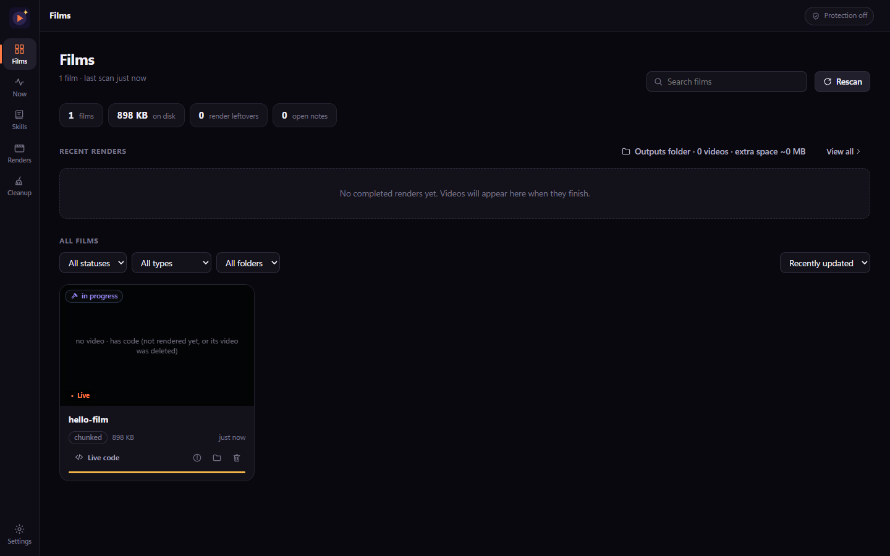
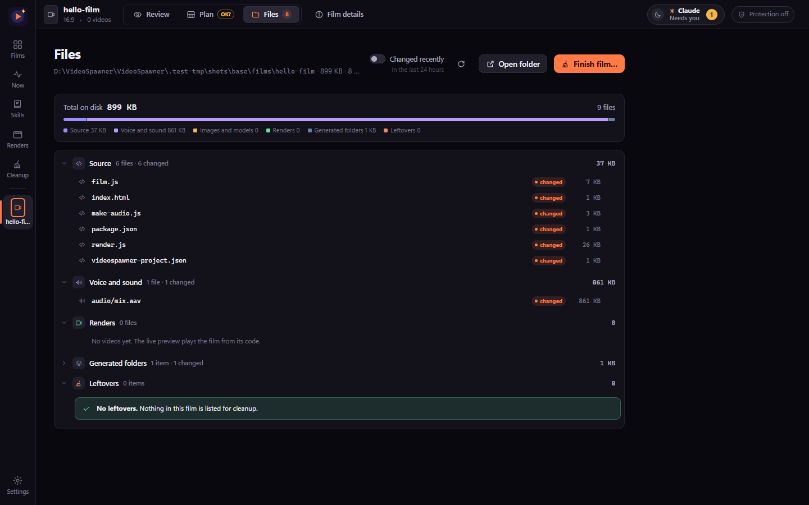
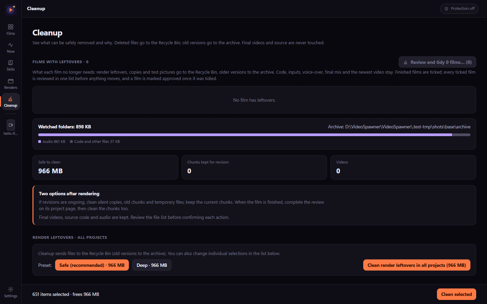
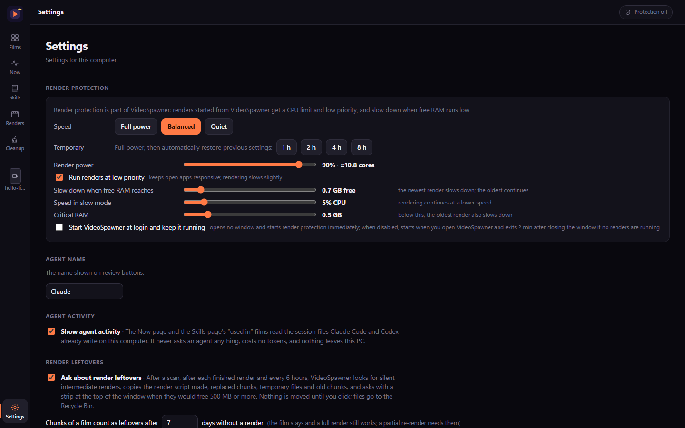

# VideoSpawner

**Студія для відео, які пише код. Claude робить фільм, ти дивишся, тикаєш у кадр з багом, а Claude фіксить.**

VideoSpawner — локальний додаток, який з'єднує тебе і Claude Code під час роботи над відео. Claude пише фільм як веб-сторінку, де кожен кадр малюється кодом. VideoSpawner показує його наживо, без рендеру. Ти ставиш нотатку прямо на кадр («тут сонце має бути помаранчевим»), тиснеш **Send to Claude**, і агент одразу отримує час, кадр і картинку з твоєю позначкою. Коли все готово, черга рендерить MP4. Після правок перерендерюються лише ті секунди, що змінились.


> Windows 10/11 (основна платформа), Linux і macOS. Працює з Claude Code, а також з Codex і OpenCode.

---

## Як це працює

```
 ти ──"зроби відео про…"──▶ Claude Code
                               │ пише film.js + index.html (кадр = функція від часу)
                               ▼
                      hub_live ──▶ VideoSpawner показує фільм наживо (без рендеру)
                               │
 ти ──клік у кадр + текст──▶ нотатка ──"Send to Claude"──▶ hub_wait повертає її агенту
                               │                            (час, кадр, кроп-картинка)
                               ▼
                      Claude правит код ──▶ прев'ю саме перезавантажується
                               │
 ти ──"рендери"──▶ hub_render ──▶ Edge/Chrome headless + ffmpeg ──▶ film_vN.mp4
```

1. **Ти просиш відео** у чаті Claude Code.
2. **Claude будує фільм** у `<workspace>/films/<назва>` за шаблоном `templates/new-film`.
3. **`hub_live`** відкриває його в VideoSpawner. Фільм грає прямо з коду, кадр у кадр, зі звуком.
4. **Нотатки.** Клікаєш або малюєш на кадрі, пишеш, що не так, і тиснеш **Send to Claude**.
5. **`hub_wait`.** Claude не завершує відповідь, а чекає на тебе. Нотатка прилітає йому миттєво, він правит код, позначає її виправленою і знову чекає.
6. **Рендер** запускається тільки коли ти скажеш. Одночасно йде лише один рендер, з захистом CPU/RAM.

## Рендер

Remotion тут не використовується. Рендер власний і простий:

- **Фільм — це HTML-сторінка з `<canvas>` 1920×1080.** Вона дає `window.renderOut(t)`, що малює секунду `t`, і `window.READY = true`. Кадр — чиста функція від часу, тому будь-який кадр можна намалювати в будь-якому порядку.
- **`render.js`** відкриває сторінку в headless Edge/Chrome (`puppeteer-core`) і ріже фільм на шматки по 2 секунди (`render/chunks/c_000.mp4`…), які кілька воркерів рендерять паралельно.
- **Пікселі** читаються прямо з canvas і йдуть по локальному WebSocket в **ffmpeg** як сирий RGBA, без втрат. Якщо сторінка складніша, робляться PNG-скріншоти.
- **Кодек:** відеокарта (NVENC, AMF, QSV, VAAPI або VideoToolbox), а якщо її немає, то x264.
- **Частковий ререндер.** Кожна нотатка знає свій шматок, тож після правки рендеряться лише ці шматки (`ONLY=2,3`), склеюються і отримують звук `audio/mix.wav`.

## Сторінки

| | |
|---|---|
|  |  |
|  |  |
|  |  |

- **Films** — усі фільми з робочої папки: жива обкладинка з коду, статус, нотатки.
- **Review / Plan / Files** — плеєр з нотатками, план сценами, файли фільму.
- **Now** — що зараз роблять агенти. Читає журнали Claude Code локально і не витрачає жодного токена.
- **Skills** — скіли твоїх агентів і фільми, де вони використовувались.
- **Renders** — черга рендерів, прогрес, ETA, кнопки «повільніше» і «стоп».
- **Cleanup** — сміття після рендерів. Усе йде тільки в Кошик і тільки після твого підтвердження.

## Інструменти для агента (MCP)

`hub_live`, `hub_wait`, `hub_notes`, `hub_note_update`, `hub_plan`, `hub_ask`, `hub_render`, `hub_job`, `hub_project`, `hub_workspace`, `hub_register_version`, `hub_cleanup`, `hub_finish`.

MCP-сервер називається `videospawner`. Без MCP ті самі команди працюють так: `node server/cli.js <tool> "<json>"`.

## Встановлення

Потрібні **Node.js 22+**, **ffmpeg** у PATH, **Edge або Chrome** і **Claude Code**.

```powershell
git clone https://github.com/KrArsen/VideoSpawner.git
cd VideoSpawner
npm install
node scripts/install.mjs setup --agents claude
```

На Windows можна просто двічі клацнути **SETUP.cmd**. Setup створить робочу папку (films, outputs, sounds, archive), зареєструє MCP-сервер у Claude Code, додасть скіл і правило «спершу прев'ю, потім рендер», а також ярлик на робочому столі. Після цього **відкрий нову сесію Claude Code**: інструменти `hub_*` з'являться саме там.

Запуск: ярлик **VideoSpawner** або `open.cmd` (Windows), `./open.sh` (Linux/macOS). Адреса: http://127.0.0.1:7790.

Сухий прогін без змін: `node scripts/install.mjs setup --dry-run`. Видалення: `node scripts/install.mjs uninstall`. Фільми, нотатки й налаштування при цьому лишаються.

## Чим VideoSpawner відрізняється від VideoHub

VideoSpawner — форк [VideoHub](https://github.com/TensaikunYT/Videohub) (MIT). Що змінено:

- **Новий бренд і дизайн:** фіолетово-чорна тема, помаранчевий «спавн»-акцент, новий логотип, округліші елементи.
- **Окремий порт 7790, MCP `videospawner`, змінні `VIDEOSPAWNER_*`, папка фільму `.videospawner/`.** Можна ставити поруч з оригіналом.
- **Виправлено зависання хаба.** Прибиральник порівнював кожен знайдений профіль Chrome у `%TEMP%` з кожним іншим і щоразу ходив на диск. Через 600+ старих профілів сервер не відповідав по кілька хвилин. Тепер кожен шлях резолвиться один раз.
- **Виправлено ярлик на робочому столі** для Windows з кириличною назвою папки («Рабочий стол»).

## Безпека

Сервер слухає тільки `127.0.0.1` і відхиляє запити з чужих сайтів. Черга рендерів уміє запускати команди, тому **не відкривай порт 7790 назовні**: без проброса портів і без тунелів. Видалення йде тільки в Кошик, ніколи не напряму.

## Розробка

`npm test` проганяє всі тести. Архітектура описана в [docs/ARCHITECTURE.md](docs/ARCHITECTURE.md), контракт фільму — в [docs/PROJECT-CONTRACT.md](docs/PROJECT-CONTRACT.md), правила для агентів — у [CLAUDE.md](CLAUDE.md).

## Ліцензія

[MIT](LICENSE). Оригінальний код © 2026 VideoHub contributors, зміни VideoSpawner © 2026 KrArsen.
